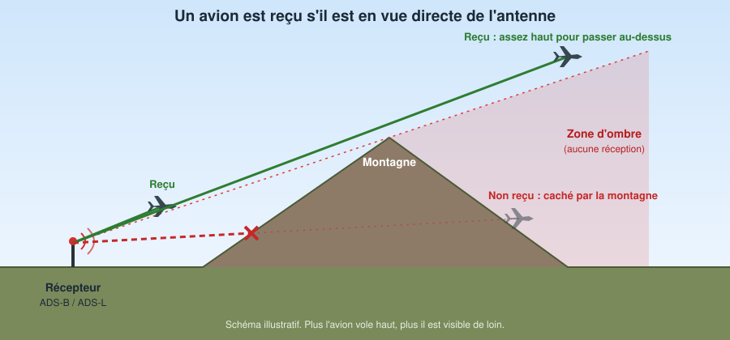
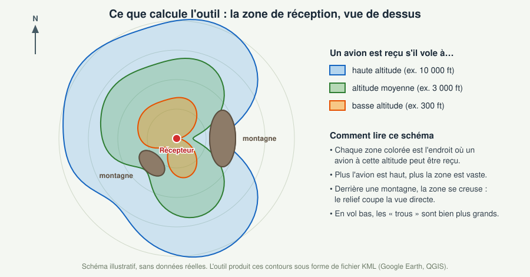
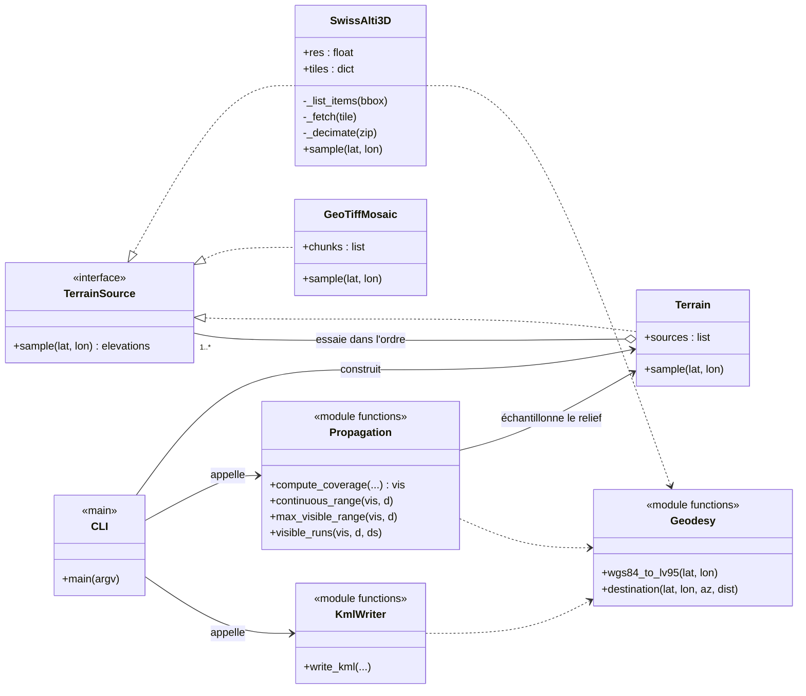
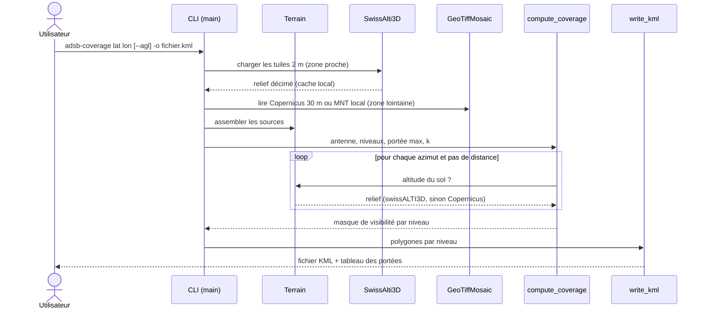

# adsb-coverage

Couverture de réception **théorique** d'un récepteur fixe ADS-B (1090 MHz) / ADS-L au sol :
visibilité radioélectrique directe (LOS) avec **rayon terrestre effectif** (k = 4/3 par défaut) et
**masquage par le relief**. Entrée : latitude / longitude. Sortie : **KML** (Google Earth, QGIS).

## En bref (pour tout public)

Un récepteur ADS-B / ADS-L capte les messages que les aéronefs émettent en continu (position, altitude,
identification). Ces ondes voyagent **en ligne droite** : si une montagne se trouve entre l'avion et
l'antenne, le signal est bloqué, et la rondeur de la Terre cache aussi les avions trop bas et trop lointains.
L'outil calcule **jusqu'où** un récepteur donné peut « voir » des avions, selon leur altitude.



Le résultat est une carte de la zone de réception, une zone par altitude de vol : plus l'avion vole haut,
plus il est visible de loin, et le relief creuse des « trous » derrière les montagnes, surtout pour les vols bas.



## Installation

```
pip install -e .            # numpy + requests
pip install -e ".[geotiff]" # + rasterio (relief lointain Copernicus / MNT local)
```

## Utilisation

```
# altitudes AMSL (défaut : 1000 … 30000 ft)
adsb-coverage 46.9480 7.4474 --ant-h 15 -o bern.kml

# basses altitudes, hauteurs au-dessus du sol local
adsb-coverage 46.9480 7.4474 --agl --alt-ft 30,100,300,1000 --near-res-m 10 -o bas.kml
```

Résumé des portées affiché en console ; un polygone par niveau dans le KML
(en mode `--agl`, zones visibles secteur par secteur).

## Architecture (UML)

Diagrammes [Mermaid](https://mermaid.js.org/), affichés directement par GitHub. `TerrainSource` est une
convention (typage « canard » : toute source de relief expose `sample(lat, lon)`), pas une classe du code.

### Classes et modules



### Déroulement d'un calcul



## Modèle

Pour chaque azimut, le relief est échantillonné le long d'un rayon. Dans un repère « terre aplatie »
(hauteur apparente h − d²/(2·k·R)), un aéronef est visible si la pente antenne→aéronef est ≥ à la
pente maximale du relief rencontré. Pas de zone de Fresnel, de bilan de liaison, ni d'obstacles
artificiels (bâtiments, végétation) : c'est de la visibilité géométrique.

## Topographie

| Source | Usage | Remarques |
|---|---|---|
| [swissALTI3D](https://www.swisstopo.admin.ch/de/hoehenmodell-swissalti3d) (swisstopo, 2 m) | zone proche (`--near-km`, défaut 10 km) | téléchargement automatique via l'API STAC, mis en cache dans `~/.cache/adsb_coverage`, décimé à `--near-res-m` (défaut 50 m). Sol nu. |
| [Copernicus GLO-30](https://registry.opendata.aws/copernicus-dem/) (30 m) | reste du domaine | lecture basse résolution (`--far-res-m`, défaut 300 m), nécessite `rasterio` |
| GeoTIFF local EPSG:4326 | `--dem fichier.tif` | |

Réseau d'entreprise : `--proxy http://hote:port`, `--ca-bundle ca.pem`, ou mode hors ligne
`--tile-dir` (tuiles swissALTI3D `.xyz.zip` téléchargées à la main).

## Limites connues / à faire

- Téléchargement Copernicus (URL des tuiles) et lecture GeoTIFF à valider sur le terrain.
- Migration de l'API STAC v0.9 (dépréciée, active au moins jusqu'à fin 2026) vers v1.
- Option `--alt-m`, détection automatique du proxy système.
- Comparaison avec la portée observée dans des logs réels (par azimut), calibration de k.
- Obstacles artificiels (swissSURFACE3D), zone de Fresnel, bilan de liaison.

## Développement

```
pip install -e ".[dev]"
pytest
```

Licence : à définir.
