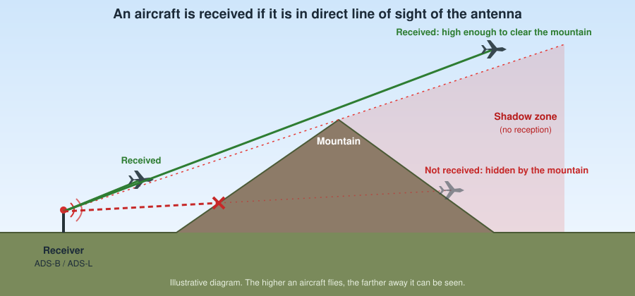
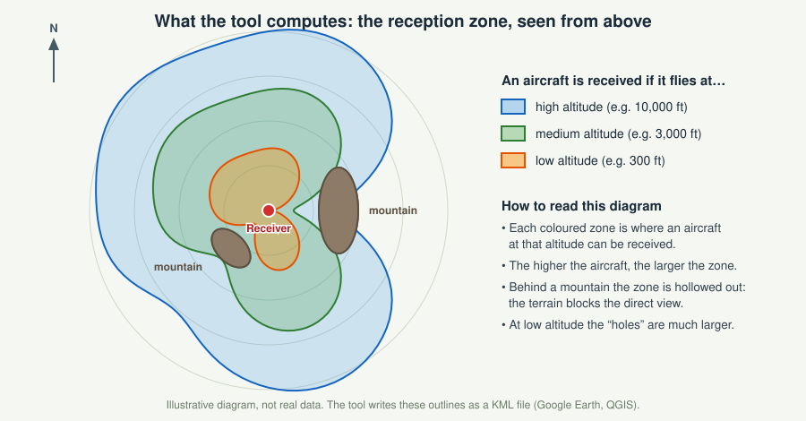
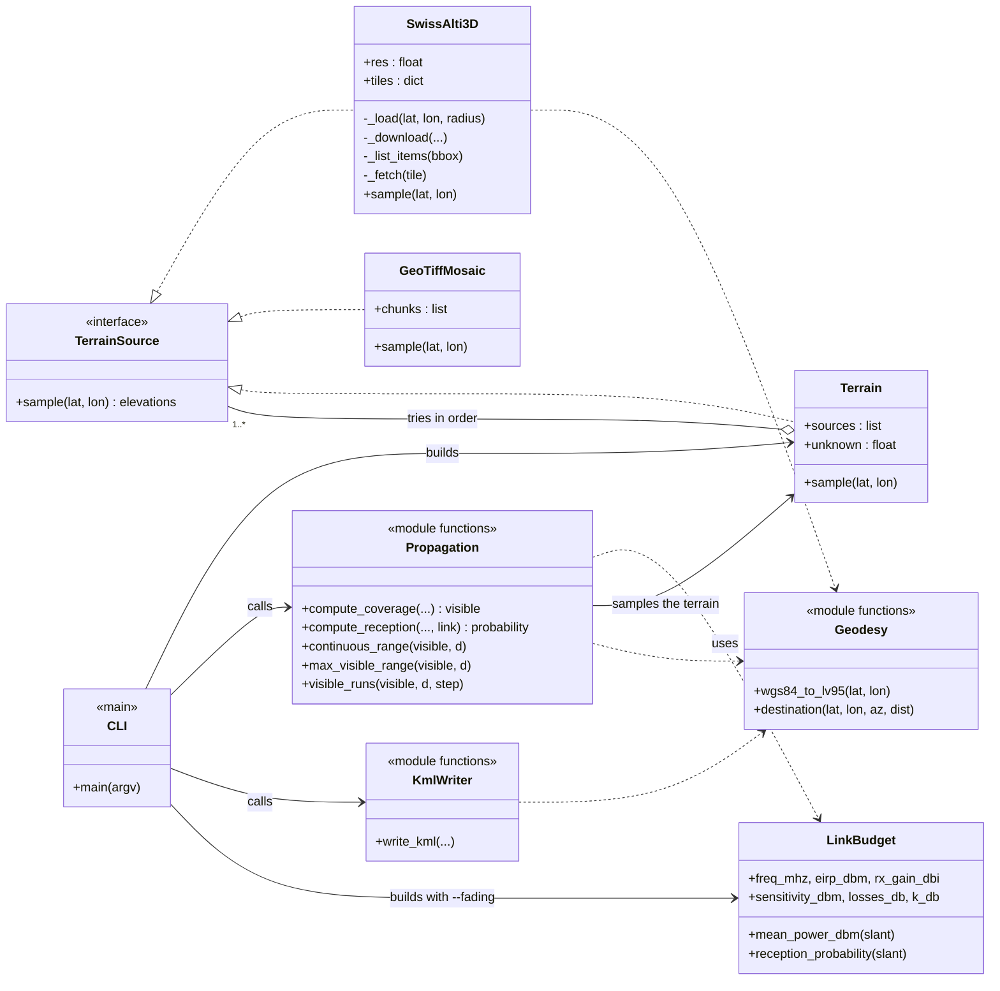
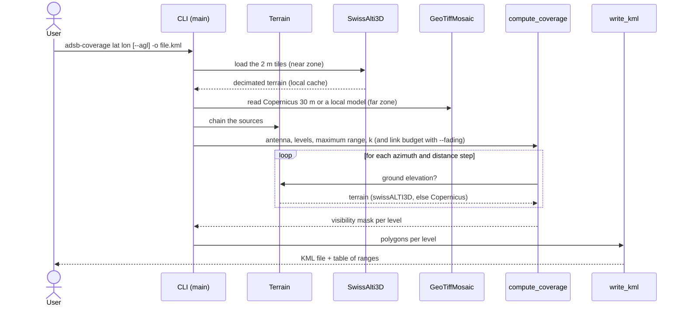

# adsb-coverage

**Theoretical** reception coverage of a fixed ADS-B (1090 MHz) / ADS-L ground receiver: line of sight (LOS)
with an **effective Earth radius** (k = 4/3 by default) and **terrain masking**. Input: latitude and longitude.
Output: a **KML** file (Google Earth, QGIS).

## At a glance (for a general audience)

An ADS-B / ADS-L receiver picks up the messages that aircraft broadcast continuously (position, altitude,
identification). These radio waves travel **in a straight line**: if a mountain lies between the aircraft and
the antenna, the signal is blocked, and the curvature of the Earth also hides aircraft that are low and far away.
The tool computes **how far** a given receiver can "see" aircraft, depending on their altitude.



The result is a map of the reception zone, one zone per flight level: the higher an aircraft flies, the farther
it can be seen, and the terrain hollows out "holes" behind mountains, especially for low flights.



## Installation

```
pip install -e .            # numpy + requests
pip install -e ".[geotiff]" # + rasterio (far terrain from Copernicus, local terrain models)
pip install -e ".[fading]"  # + scipy (--fading rice)
```

Python 3.9 to 3.13 (tested by the continuous integration on every push).

## Usage

```
# altitudes AMSL (default: 1000 ... 30000 ft)
adsb-coverage 46.9480 7.4474 --ant-h 15 -o bern.kml

# low altitudes, heights above the local ground
adsb-coverage 46.9480 7.4474 --agl --alt-ft 30,100,300,1000 --near-res-m 10 -o low.kml
```

A summary of the ranges is printed on the console, and the KML has one layer per level (with `--agl`, the visible
sectors are drawn one by one). `adsb-coverage --help` lists all the options.

With `--fading`, the drawn zone is where a message is received with at least a given probability (see
[Reception probability](#reception-probability-optional---fading)). All the link budget values must then be given:

```
adsb-coverage 46.9480 7.4474 --agl --fading rice --k-db KDB --prob 0.9 \
    --freq-mhz F --eirp-dbm P --rx-gain-dbi G --losses-db L --sensitivity-dbm S -o reception.kml
```

`--fading rayleigh` needs no `--k-db`. The same options exist in the online workflow below.

## Online calculation (GitHub Actions)

The repository contains a workflow that computes a coverage without installing anything, from GitHub's servers
(direct access to swisstopo and Copernicus, no corporate proxy):

1. Open the **Actions** tab, select the workflow **"ADS-B / ADS-L coverage"** and click **Run workflow**.
2. Enter the latitude, longitude, mode (`agl` or `amsl`), antenna height and, if needed, the levels in ft.
3. When the run has finished, download the KML from the **Artifacts** section (kept for 30 days); the table of
   ranges appears in the run summary.

The inputs are validated (numbers only, bounded ranges) before anything is computed. Write access to the
repository is needed to start the workflow. On a public repository, the parameters entered are visible in the
run history.

## Example

[`examples/bern-agl-low-altitudes.kml`](examples/bern-agl-low-altitudes.kml): low-altitude coverage
(`--agl` mode) computed by the GitHub Actions workflow for a receiver at 46.9744 N, 7.4771 E
(ground at 521 m, antenna 10 m above ground, k = 4/3), for aircraft 15, 30, 60, 90, 120 and 150 ft above ground.

| Height above ground | Max continuous range | Max visible range |
|---|---|---|
| 150 ft | 6 km | 82 km |
| 120 ft | 5 km | 81 km |
| 90 ft | 4 km | 81 km |
| 60 ft | 4 km | 81 km |
| 30 ft | 2 km | 81 km |
| 15 ft | 2 km | 81 km |

*Continuous range*: distance to the first obstruction by the terrain. *Visible range*: farthest visible point, even
behind a ridge (at low altitude an aircraft can reappear above a distant, higher relief).

**Opening it in Google Earth**

1. **Google Earth Pro** (desktop): [download the file](https://github.com/raphaelcere/clarke-model-generator/raw/main/examples/bern-agl-low-altitudes.kml)
   (right-click, "Save link as..."), then double-click the `.kml`, or *File, Open*.
2. **Google Earth web** ([earth.google.com/web](https://earth.google.com/web/)): *Projects*, *Open*, *Import KML file from computer*,
   then pick the downloaded file. The file is large (about 1 MB), so the import can take a few seconds.
3. **QGIS**: drag and drop the file into the window.

## Architecture (UML)

[Mermaid](https://mermaid.js.org/) diagrams, rendered directly by GitHub. `TerrainSource` is a convention
(duck typing: every terrain source exposes `sample(lat, lon)`), not a class in the code.

### Classes and modules



### Sequence of a calculation



## Model

### Line of sight

For each azimuth, the terrain is sampled along a profile. The effective Earth radius is k R with k = 4/3, the
standard atmosphere value [2] (Recommendation ITU-R P.834, Annex 1, section 2: R<sub>e</sub> = k a, equation (3) for k,
and k = 4/3 as the standard value). In the "flat Earth" frame, the usual parabolic approximation of the Earth bulge,
a point at distance d and height h has the apparent height h - d<sup>2</sup>/(2 k R). An aircraft is visible if the slope
from the antenna to the aircraft is at least the steepest slope to any terrain met so far.

### Reception probability (optional, `--fading`)

On top of the geometry, the tool can estimate the probability that a message is received.

1. **Mean power.** Free-space link budget at the slant range d [5]:
   P<sub>mean</sub> = EIRP + G<sub>rx</sub> - L - 20 log<sub>10</sub>(4 pi d f / c) (dBm), with the receiving antenna gain
   G<sub>rx</sub> and the losses L taken as constant.
2. **Fading around the mean.** Clarke's model [1], section 2.1 (pp. 961-962): the field is the sum of N randomly phased
   waves, so its components are complex Gaussian (central limit theorem) and the envelope is **Rayleigh** distributed. If a
   direct wave of significant magnitude is added to the scattered ones, the envelope is **Rice** distributed
   (Rice [3]; Clarke refers to Davenport and Root [4], pp. 160-161 for the Rayleigh case and pp. 165-167 for the Rice case).
3. **Probability.** A message is received when the instantaneous power exceeds the sensitivity S. With
   s = S / P<sub>mean</sub> (linear):
   - Rayleigh: P = exp(-s), because the power of a Rayleigh envelope is exponentially distributed;
   - Rice with K-factor K (direct over scattered power, linear): P = Q<sub>1</sub>(sqrt(2K), sqrt(2(K+1)s)), the survival function
     of a non-central chi-square variable with 2 degrees of freedom; K = 0 gives the Rayleigh case.

   These two closed forms are standard consequences of the envelope distributions; Clarke's paper does not write them out.
4. **Zone.** Points that are not in line of sight get probability 0; the KML shows where the probability is at least `--prob`.

Only the first-order statistics of [1] (section II) are used. Its signal spectrum (Doppler), frequency correlation and
time-delay results are not.

**Caveats.** Clarke's model describes a receiver moving through a scattering environment, with the direct path often
obstructed. For an aircraft in line of sight of a fixed ground receiver, Rice is the closer case and the K-factor is an input
that the tool does not derive: Rayleigh (K = 0) is the pessimistic limit. Ground reflections (two-ray), antenna patterns and
man-made obstacles are not modelled, and the link budget values (EIRP, gains, sensitivity) are inputs, not defaults.

## Terrain data

| Source | Use | Notes |
|---|---|---|
| [swissALTI3D](https://www.swisstopo.admin.ch/en/height-model-swissalti3d) (swisstopo, 2 m) | near zone (`--near-km`, default 10 km) | downloaded automatically through the STAC API, cached in `~/.cache/adsb_coverage`, decimated to `--near-res-m` (default 50 m). Bare ground. |
| [Copernicus GLO-30](https://registry.opendata.aws/copernicus-dem/) (30 m) | rest of the domain | low-resolution read (`--far-res-m`, default 300 m), requires `rasterio` |
| Local EPSG:4326 GeoTIFF | `--dem file.tif` | |

Corporate network: `--proxy http://host:port`, `--ca-bundle ca.pem`, or offline mode with `--tile-dir`
(swissALTI3D `.xyz.zip` tiles downloaded by hand).

## Known limitations and to do

- Copernicus tile download and GeoTIFF reading still need validating in the field (the continuous integration only
  tests a synthetic GeoTIFF).
- Migration of the STAC API from v0.9 (deprecated, active at least until the end of 2026) to v1.
- `--alt-m` option, automatic detection of the system proxy.
- Comparison with the range observed in real logs (per azimuth), calibration of k.
- Man-made obstacles (swissSURFACE3D), Fresnel zone, ground reflection (two-ray), antenna patterns.
- Presets for the link budgets of ADS-B (1090 MHz) and ADS-L, once the values are confirmed.

## References

1. R. H. Clarke, "A Statistical Theory of Mobile-Radio Reception", *Bell System Technical Journal*, vol. 47, no. 6, pp. 957-1000, July-August 1968.
   Used for the scattering model and the Rayleigh / Rice envelope (section 2.1, pp. 961-962).
2. Recommendation ITU-R P.834, "Effects of tropospheric refraction on radiowave propagation", Annex 1, section 2 (effective Earth radius, k = 4/3).
   Read in version P.834-3; check the current version before citing a page.
3. S. O. Rice, "Statistical Properties of a Sine Wave Plus Random Noise", *Bell System Technical Journal*, vol. 27, no. 1, pp. 109-157, January 1948.
   Cited by [1]; not consulted for this tool.
4. W. B. Davenport and W. L. Root, *An Introduction to the Theory of Random Signals and Noise*, McGraw-Hill, New York, 1958, pp. 160-161 and 165-167.
   Page numbers as cited by [1] (p. 962); not consulted for this tool.
5. H. T. Friis, "A Note on a Simple Transmission Formula", *Proceedings of the IRE*, vol. 34, no. 5, pp. 254-256, May 1946.

## Development

```
pip install -e ".[dev]"
pytest
```

The tests are also run by GitHub Actions (workflow "Tests") on Python 3.9 to 3.13 at every `push` to `main`.

Licence: to be defined.
